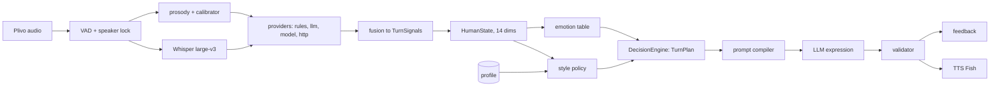

# SalesGod (ACIE) architecture, as the code is now

Snapshot: branch `lane/docs`, from `build/acie-complete` @ `c2e6be6`. Every number below is read from the code at that commit;
`path:line` points at it. The standalone, browsable version of this file is `docs/ARCHITECTURE.html`. Flags are in
`docs/FLAGS.md`; what is done and what is left, layer by layer, is in `docs/STATUS.md`.

Two things are NOT on this commit and are described in section 14 only, clearly marked: the XGBoost turn classifier
(`lane/ml` @ `c7e0562`, not merged) and the numbers measured on the live server (given by the coordinator, not stored in the repo).

---

## 0. The idea in one screen

The LLM only phrases. What the agent does is decided before the LLM is called, by rules, tables, small learned models with
fixed parameters, and business facts. The LLM sees a `TurnPlan` (objective, `{slot}` placeholders, `must_not_say`, ask) and is
not allowed to write a number; the validator fills the real values in afterwards and replaces the whole reply with the reviewed
template if anything is wrong.

```
 caller audio (8 kHz mu-law, Plivo)
   -> VAD (Silero) -> speaker lock (WeSpeaker) -> STT (Whisper large-v3) ; prosody + calibrator in parallel     voice/call.py:423
   -> ACIEPipeline.run_turn                                                                                      acie/pipeline.py:207
        L1-2  providers: rules (+ llm NLU, + model, + http)  -> fuse -> TurnSignals -> 14-dim HumanState (EMA)  pipeline.py:108
        L3    explicit requests -> long-term profile -> style policy (rules | LinUCB | XGBoost) -> ExpressionParams
        L2b   emotion table (11 rows) -> crisis override ; need table -> move (ACIE_PSYCHE=1)
        L4    DecisionEngine -> ProductSalesDomain -> TurnPlan  ; repeat guard (SaidLedger)
        L5    PromptCompiler  (only if plan.llm_allowed)
        L6    LLM expression (Qwen3-14B-AWQ, vLLM)  |  TemplateBackend (the plan's reviewed fallback)
        L7    StreamingValidator (per sentence)  -> safe template on any failure
        L8    FeedbackEngine (reward, profile learning, memory)
   -> sentences stream to TTS (Fish Audio, 8 kHz PCM) -> mu-law -> Plivo
```



---

## 1. Deterministic before the LLM (the guarantee, stage by stage)

Order inside one turn (`acie/pipeline.py:207-430`): understand -> profile -> explicit requests -> style policy -> emotion row ->
(need, move) -> decision plan -> repeat guard -> compile -> LLM wording -> validate. Everything before "LLM wording" is a function
of (text, timing, prosody, session, profile, flags), with these exceptions, stated plainly:

| stage | deterministic? | note |
|---|---|---|
| rules provider (keywords, lexicons) | yes | pure Python, `acie/providers/rules.py` |
| `model` provider (trained classifier) | yes | single-thread predict, ties to the lowest class index (lane/ml) |
| `llm` provider (NLU, Qwen3-14B-AWQ) | NO (near) | temperature 0 and guided JSON (`acie/understanding.py:128,130`), but a GPU LLM is not bit-exact. It is ON in the voice server (`voice/server.py:111` passes `nlu` for every non-template backend). With `ACIE_SIGNAL_PROVIDERS=rules` the hearing step is fully deterministic (`acie/providers/hub.py:19`). |
| fusion, EMA, policy, tables, moves, ledger, plan | yes | no `random`, no `hash()`, sorted iteration, crc32 only (`acie/signals_fusion.py:5`, `acie/psyche/needs.py:195`, `acie/memory/hashing.py:25`) |
| LinUCB / XGBoost style policies | yes | posterior mean, no exploration bonus at decision time (`acie/personalization/bandit.py:205`) |
| expression LLM | NO | temperature 0.3 by default (`acie/expression.py:95`), 0.0 under `ACIE_PSYCHE=1` (`:104`). It cannot change the plan: `llm_allowed=False` plans never reach it (`acie/pipeline.py:318`) and the validator checks the rest |
| A/B backend choice | yes per session | sha256 of `salt|session_id` (`acie/expression.py:239`); `random.random()` only when no session key exists (`:241`) |
| playbook generation (frontier model, temp 0.4) | NO | offline authoring, never in the call path (`acie/playbook.py:180`); the live picker is deterministic (section 7.4) |

What the LLM can and cannot do (`acie/compiler.py:121-141`, `acie/validator.py:160-195`): it gets facts only as `{slot}`
placeholders; any digit, rupee sign, number word, invented slot, wrong script, or rule-pack hit fails the sentence and the whole
reply becomes the plan's reviewed fallback.

---

## 2. Models: every model, where it runs, on or off

"Live" = on the production voice server path by default in code. Production `.env` is not in the repo; "flag" rows are off unless the
flag is set, and per the lane brief all flags added by the lanes are unset in production.

| # | model | size | precision | where | state | evidence |
|---|---|---|---|---|---|---|
| 1 | Whisper `large-v3` (faster-whisper, CTranslate2) | not stated in code | float16 | GPU (`device="cuda"`), concurrency `STT_CONCURRENCY`=4 | live | `voice/stt.py:16-19` |
| 2 | Silero VAD v5.1.2 | not stated in code | ONNX (precision not stated) | CPU, 1 intra + 1 inter thread | live | `voice/vad.py:149-163` |
| 3 | WeSpeaker ResNet34-LM speaker embedding | 256-d output | ONNX | CPU, 2 intra threads | live | `voice/speaker.py:21-30,46-53` |
| 4 | YIN pitch tracker + calibrator (numpy, not a model) | - | float32 | CPU | live reading; used by the estimator only when `ACIE_PROSODY=1` | `voice/prosody.py`, `voice/calibrator.py`, `acie/state/estimator.py:434` |
| 5 | Qwen3-14B-AWQ as NLU (`llm` provider) | 14 B (from the name) | AWQ weight quantisation | GPU, vLLM `:8000`, 0.6 of the GPU | live (voice server) | `deploy/voice/salesgod-llm.service:9-11`, `acie/understanding.py:113-130` |
| 6 | Qwen3-14B-AWQ as expression writer | 14 B | AWQ | same vLLM server, `--max-model-len 4096 --max-num-seqs 32 --enable-prefix-caching` | live | `deploy/voice/salesgod-llm.service:9-11`, `acie/expression.py:93-115` |
| 7 | Fish Audio `s2.1-pro-free` TTS | hosted | 16-bit mono PCM, 8 kHz | Fish HTTP API | live | `voice/tts.py:16,22` |
| 8 | Need classifier, XGBoost `multi:softprob` | 9 classes, 164 features | float32 inputs | CPU, 1 thread | ONLY with `ACIE_PSYCHE=1` (off) | `acie/psyche/need_model.meta.json`, `acie/psyche/needs.py:194-260` |
| 9 | Turn classifier, MuRIL (`google/muril-base-cased` default; XLM-R option) | not stated in code | bf16 on cuda, fp32 on cpu | GPU/CPU | flag `ACIE_TURN_MODEL`; trainer only, no checkpoint in repo | `training/state_classifier/train.py:120`, `predict.py:107-111` |
| 10 | Style policy: LinUCB (numpy ridge, 21 arms, d=53) | 21 x (53x53 + 53) floats | float64 | CPU | flag `ACIE_POLICY=bandit` | `acie/personalization/bandit.py:53-61,85-103` |
| 11 | Style policy: XGBoost regressor per arm | 200 trees, depth 4 | float32 | CPU, 1 thread | flag `ACIE_POLICY=xgb` | `acie/personalization/train_style.py:24-30` |
| 12 | Memory embedder: hashing (default) | 256-d | float | CPU | flag `ACIE_MEMORY=1` | `acie/memory/hashing.py:21` |
| 13 | Memory embedder: `intfloat/multilingual-e5-small` | not stated in code | normalised embeddings | CPU/GPU | flag `ACIE_EMBED=st` | `acie/memory/st.py:11` |
| 14 | Playbook planner LLM (any OpenAI-compatible frontier model) | n/a | n/a | remote | offline authoring only | `acie/playbook.py:172-189` |
| 15 | Expression LoRA (base `Qwen/Qwen2.5-7B-Instruct`, r=16, alpha=32, dropout 0.05, lr 1.5e-4, 2 epochs, bf16, max_len 3072) | 7 B base | bf16 | training box | not the live model; live unit serves base `Qwen3-14B-AWQ` | `training/expression/train_lora.py:84-101`, `deploy/serve_vllm.sh:17` |
| 16 | Teacher for SFT data: Qwen2.5-72B-Instruct, TP=4 | 72 B | bfloat16 | 4 GPUs | offline | `deploy/serve_teacher.sh:5,11,15` |

Not models, but in the loop: world lookups (`acie/world.py`: clock, Open-Meteo weather, Wikipedia; budget 2.0 s, `:68`), the business API
(mock or HTTP, `acie/business`), Redis/Postgres/pgvector/NATS (all flag-gated, section 11).

---

## 3. The 14-dim HumanState (`acie/schemas.py:80-98`, `acie/signals.py:20`)

All values in [0,1]. `b` = the neutral baseline the EMA decays toward (the field default).

| # | dim | baseline b | rule source |
|---|---|---|---|
| 1 | frustration | 0.0 | lexicon + repeat + caps/`!!` + barge-in (`estimator.py:227-236`) |
| 2 | confusion | 0.0 | lexicon + repeat + short question (`estimator.py:216-225`) |
| 3 | urgency | 0.0 | lexicon + barge-in + fast speech (`estimator.py:238-243`) |
| 4 | engagement | 0.5 | minimal reply 0.2 / question or long 0.8 / slow reply (`estimator.py:245-253`) |
| 5 | satisfaction | 0.5 | `0.5 + 0.45*like - 0.5*dislike - 0.25*frustration` (`dims.py:242`) |
| 6 | anxiety | 0.0 | lexicon score (`dims.py:249-253`) |
| 7 | excitement | 0.0 | lexicon score, `+0.15` if `!`, `+0.1` if rate > 3.5 wps (`dims.py:255-263`) |
| 8 | calmness | 0.5 | `0.5 + 0.4*calm - 0.4*frust - 0.25*anx - 0.2*urg - 0.1*barge` (`dims.py:265-272`) |
| 9 | trust | 0.5 | `0.5 + 0.4*trust_up - 0.5*trust_down` (`dims.py:274-280`) |
| 10 | certainty | 0.5 | `0.5 - 0.45*hedge + 0.4*assert - 0.1*ellipsis` (`dims.py:282-290`) |
| 11 | cognitive_load | 0.0 | load lexicon + hesitations + ellipsis + confusion>=0.6 (+0.2) + latency + repeat (`dims.py:292-314`) |
| 12 | attention | 0.5 | length/question bonuses, minimal reply -0.2 (`dims.py:316-332`) |
| 13 | participation | 0.5 | 0.2 / 0.4 / 0.65 / 0.8 by content words, +0.15 question, +0.1 barge-in (`dims.py:334-347`) |
| 14 | receptiveness | 0.5 | `0.5 + 0.4*agree - 0.5*refuse - 0.2*frust - 0.1*anx` (+0.1 question, -0.1 minimal) (`dims.py:349-359`) |

`signals: list[str]` carries the evidence strings for the turn (`schemas.py:98`). Lexicon sizes (phrases): confusion 89, frustration 192, urgency 46,
like 52, dislike 43, anxiety 54, excitement 47, calm 35, trust-up 34, trust-down 66, hedge 42, assert 35, load 55, agree 60, refuse 54
(counted by import from `acie/state/estimator.py` and `acie/state/dims.py`).

### 3.1 Lexicon score (`acie/state/estimator.py:185-188`)

```
score(hits) = min(1.0, strongest_weight + 0.15 * (number_of_distinct_hits - 1))     0 if no hit
```
Phrase syntax: `x*` suffix match, `=x` whole utterance, masks replace negated phrases first (`estimator.py:152-182`). If one phrase is inside
a longer hit only the longer one counts (`:175-181`).

### 3.2 Core four before smoothing (`estimator.py:203-258`)

```
repeated      = jaccard(text, previous_customer_turn) >= 0.6
confusion    += lex + 0.3*repeated + 0.2*(text ends "?" and <= 3 tokens)
frustration  += lex + 0.3*repeated + 0.3*(>=2 "!" or (len>8 and UPPERCASE)) + 0.25*barge_in
urgency      += lex + 0.2*barge_in + 0.2*(speech_rate > 3.5 words/s)
engagement    = 0.2 if every content word is a minimal reply; else 0.8 if "?" or >=8 tokens or (>=3 content words and a question word); else 0.5
engagement   -= 0.2 if response_latency_ms > 4000
all clamped to [0,1]
```

### 3.3 EMA with a per-dim baseline (`estimator.py:396-446`)

```
a = alpha_up   (0.7)  if r > p     else  alpha_down (0.3)          alpha defaults: estimator.py:409
H = b + a*(r - b) + (1 - a)*(p - b)           rounded to 3 decimals   (estimator.py:444-445)
```
r = raw reading this turn, p = previous smoothed value, b from `_BASELINE` = the `HumanState` field default (`:393`).
Rise fast, decay slow; a dim whose neutral value is 0.5 decays to 0.5, not to 0. Worked example: p=0, r=0.8 -> 0.56; next turn r=0 -> 0.392.

### 3.4 Prosody arousal (only with `ACIE_PROSODY=1`, `estimator.py:434`)

```
baseline = median of the caller's last 8 turns (pitch st, pitch std, loudness dB); a turn > 7.0 st away from the median is dropped from it  (:263-272)
arousal  = 0.45*clip(d_pitch/4,-1,1) + 0.30*clip(var_ratio-1,-1,1) + 0.25*clip(d_loud/6,-1,1);   x min(1, n_baseline/3)         (:298-300)
|d_pitch| > 7 st -> 0 ("probably not the same voice")                                                                            (:294-297)
```
A calibrated `VoiceReading` is preferred: `arousal = reading.arousal * reading.confidence` (`:311-319`).
`apply_prosody` (`:322-353`): arousal > 0.25 with negative words -> frustration `+0.4*a`, urgency `+0.15*a`, anxiety `+(0.4 if worried else 0.2)*a`,
calmness `-0.4*a`; with neutral/positive words -> engagement `+0.25*a`, frustration `+0.1*a`, excitement `+0.5*a`, calmness `-0.2*a`;
arousal < -0.25 -> engagement `-0.4|a|`, calmness `+0.4|a|`, excitement `-0.3|a|`.

### 3.5 Voice calibrator (`voice/calibrator.py`, per call, numpy, 10-60 ms per turn)

```
z_k       = (feature_k - centre_k) / spread_k,  centre = median of this caller's baseline turns (max 12, :43)
arousal   = clip( sum_k w_k * tanh(clip(z_k,-4,4)/2) / sum_k w_k / 0.55 , -1, 1 )                       (:215)
conf      = {1 turn: 0.5, 2 turns: 0.75, else 1.0} * min(1, voiced_seconds/0.6)
weights   pitch .32, pitch_var .18, loudness .22, effort .18, rate .10                                 (:40)
spread    defaults 1.5 / 0.6 / 3.0 / 2.5 / 0.9 (:39); fitted on 20 real calls: 0.971 / 0.578 / 1.334 / 1.694 / 0.618 (voice/assets/calib_stats.json)
calibrated once >= 2 baseline turns and >= 1.0 s voiced (:50-51), or 1 turn + a fitted pickup offset; shifts > 7.0 st = another voice (:44)
```

### 3.6 Fusion with a trained model or the NLU

* Trained turn model (`ACIE_TURN_MODEL`, legacy scorer path): `raw = round(0.5*rules + 0.5*model, 3)` per dim the model returns (`estimator.py:369-372`).
* Provider fusion (`acie/signals_fusion.py:123-134`): start from the rules' dims; every other provider is blended in turn,
  `v = round((1 - w)*v + w*x, 3)` with `w = 0.5` (`:37`); `learned_state` is the learned providers' own reading.
* Legacy NLU path (no `TurnSignals`): `0.5/0.5` per dim the NLU supplies (`estimator.py:428-432`). The NLU supplies the 4 core dims, and all 14 only with `ACIE_NLU_STATE_DIMS=1` (`understanding.py:66`).

---

## 4. Layer 1-2: hearing (providers -> TurnSignals)

`SignalHub.run` (`acie/providers/hub.py:167-181`): the rules run first and are never skipped; the others run in parallel, each under a hard
budget (`asyncio.wait_for`, `:159`); late or failing providers are dropped (rules-only turn).

| provider | name | budget | needs guide | skipped when | evidence |
|---|---|---|---|---|---|
| keyword rules + lexicon scorer | `rules` | 1.0 s | - | never | `providers/rules.py:12` |
| LLM NLU | `llm` | `nlu.timeout_s + 0.5` = 3.0 s (`ACIE_NLU_TIMEOUT_S` 2.5) | yes | rules sure (intent in `callback`, `human_agent`) and <= 6 words | `providers/llm.py:15-18`, `providers/hub.py:177` |
| trained classifier | `model` | 1.0 s | - | no model loaded | `providers/trained.py:13` |
| HTTP service | `http` | `ACIE_SIGNAL_HTTP_TIMEOUT_S` (1.5) + 0.5 = 2.0 s | - | no URL | `providers/http.py:27-28` |

Unset `ACIE_SIGNAL_PROVIDERS` = `rules`, plus `llm` when the pipeline has an NLU (`providers/registry.py:354-357`).

### 4.1 Fusion rules (`acie/signals_fusion.py:30-142`)

```
intent   rules' intent is the base; each other provider may REPLACE it only if
           label maps into the domain vocabulary (else "unknown", ignored)
           confidence >= min_confidence    model: 0.6 (ACIE_TURN_MODEL_THRESHOLD)   others: 0.0
           others only replace an intent in FILL_SET = [unknown, tell_more, benefits, goodbye, affirm, deny]
           model never replaces rule-first intents (clarify, human_agent, callback ...)  and a gated label (affirm/deny) needs its dialog key
objection, question_topic, buying_interest, garbled, gist:  first provider in [llm, http, model, fake, rules] that has a value
state    14 dims: rules value, then each learned provider 0.5/0.5 in provider order
```

### 4.2 NLU (`acie/understanding.py`)

One call per turn: `temperature 0`, `max_tokens 110` (230 with `ACIE_NLU_STATE_DIMS=1`), `guided_json` schema (intent enum from the domain
guide, `buying_signal` 0..1, `question_topic`, `objection`, the four core dims, `gist` <= 90 chars), history = last 6 turns, timeout 2.5 s.
On any error it returns `None` and the rules decide alone (`:128-137`).

---

## 5. Layer 3: personalization

### 5.1 Long-term profile and confidence update (`acie/personalization/profile_store.py:52-75`)

```
explicit statement:  value = v, confidence = 1.0, explicit = True  (locks until another explicit statement)
no entry yet:        confidence = lr
same value:          confidence = round(min(1, c + lr*(1 - c)), 3)
different value:     confidence = round(max(0, c - lr), 3); if confidence < 0.3 the value flips and confidence = lr
```
The policy acts on a stored preference only if `explicit` or `confidence >= 0.6` (`policy.py:84,140`).
Learning rates (`learner.py:24-25`): `LR = 0.1` (pronoun/explicit-marker evidence), `LR_WEAK = 0.05` (length/state evidence). Examples: verbosity "low" when <= 4 tokens
(`LR_WEAK`), "high" when >= 25 (`LR_WEAK`), "med" 8-24 tokens (`LR_WEAK/2`); formality from aap/ji vs tum/bhai (`LR`); complexity "high" on jargon (`LR_WEAK`), "low" on "samajh nahi" (`LR`);
`likes`/`dislikes`/`topics` lists capped at 20 (`learner.py:23`). Language is updated every turn with `lr=0.15` (`feedback.py:162`); complexity nudged
down with `lr=0.15` when confusion >= 0.5 and reinforced with `lr=0.05` when confusion < 0.2 and frustration < 0.2 (`feedback.py:166-170`).

### 5.2 Explicit requests (`policy.py:16-102`, `knobs.py`)

Regex tables on normalised, space-padded text; a block pattern cancels a value ("hindi nahi aati"); the last occurrence wins. Keys: `language` (en/hi/hinglish),
`verbosity`, `complexity`, `regional_variant` (delhi, mumbai, lucknow, bihar, south_indian_english), `explanation_style`, `info_density`, `reassurance`.
"Hindi mein bhi baat karta hai kya?" is a question about the product, not a switch (`pipeline.py:226-228`).

### 5.3 Rule policy A_t = pi(H_t, P_t, C_t) (`policy.py:123-241`)

Schmitt trigger (`policy.py:110-116`): `on` at `value >= enter`, `off` at `value <= exit`, otherwise keep the previous flag.

| flag | input | enter / exit | line |
|---|---|---|---|
| confused | `max(confusion, 0.5 if intent=="clarify")` | 0.5 / 0.3 | `:157` |
| frustrated | frustration | 0.5 / 0.3 | `:158` |
| urgent | urgency | 0.5 / 0.3 | `:159` |
| disengaged | `1 - engagement` | 0.7 / 0.5 | `:160` |
| anxious | anxiety | 0.5 / 0.3 | `:162` |
| distrustful | `1 - trust` | 0.7 / 0.5 | `:163` |
| overloaded | cognitive_load | 0.5 / 0.3 | `:164` |
| certain | certainty | 0.7 / 0.5 | `:165` |
| engaged | engagement | 0.7 / 0.5 | `:166` |

Effects (later rules win; "protected" = a learned policy must never override): confused -> complexity low, verbosity high->med, proactivity low;
frustrated -> warmth high, verbosity low, proactivity low, formality high (unless low -> med), `acknowledge_emotion` at most once per 3 turns (`ACK_COOLDOWN_TURNS`, `:83`);
urgent -> verbosity low, proactivity low; disengaged (and not confused/frustrated) -> verbosity low; anxious or distrustful -> reassurance high + step_by_step;
overloaded -> info_density low + complexity low; certain and engaged -> info_density high. Explicit requests then overwrite; a safety-flagged call protects every knob.
Language: explicit > explicit profile > mirror the caller; an implicit switch needs 1 turn of >= 4 words or 2 consecutive turns (`LANGUAGE_SWITCH_STREAK = 2`, `:82,240`).

### 5.4 Learned style policies (flags, off)

Shared decision rule (`bandit.py:135-159`): start from the rule policy's output; for each unprotected knob, among actions with `>= min_obs` observations, take the argmax of the
predicted reward (ties -> earlier action); change the knob only if `pred(best) - pred(rule) > margin`. Defaults `min_obs = 30`, `margin = 0.1` (`bandit.py:191-192`;
`ACIE_STYLE_MIN_OBS`, `ACIE_STYLE_MARGIN` for the XGBoost one, `xgb_style.py:34-35`). 7 knobs x 3 actions = 21 arms (`bandit.py:53-57`).

**Context** `x` binary, `d = 53 = 14*3 + 3 + 4 + 3 + 1` (`bandit.py:61`): 14 dims bucketed low/mid/high at 1/3, 2/3 (42); language one-hot (3); turn-index bucket {0, 1-2, 3-5, 6+} (4);
mean profile-confidence bucket {<0.3, <0.6, >=0.6} (3); bias (1) (`bandit.py:70-82`).

**LinUCB posterior mean** (`bandit.py:85-103`): per arm `A = lambda*I + sum x x^T`, `b = sum r x`, `theta = A^-1 b`, `mean(x) = theta . x`, `lambda = 1`, `A^-1` kept by
Sherman-Morrison: `A^-1 <- A^-1 - (A^-1 x)(A^-1 x)^T / (1 + x^T A^-1 x)`. Rewards clipped to [-1,1]. The optimistic bound `mean + alpha*sqrt(x^T A^-1 x)`
(`ACIE_BANDIT_ALPHA` 1.0) exists for offline analysis only (`:205-208`); decisions use the pure mean. State JSON at `ACIE_BANDIT_STATE` (`data/bandit.json`), saved every 20 observations, atomic write.

**XGBoost style policy** (`ACIE_POLICY=xgb`, `xgb_style.py`, `train_style.py:24-30`): one regressor per arm, fixed
`tree_method=exact, n_estimators=200, max_depth=4, learning_rate=0.1, subsample=1.0, colsample_bytree=1.0, n_jobs=1, random_state=0`, objective `reg:squarederror`.
Trained offline from the JSONL log (`ACIE_STYLE_LOG`); live `observe` only appends a row. Arms with fewer than `--min-obs` (30) rows get no model and keep the rule action.

---

## 6. Layer 2b: emotion table, needs, moves, ledger (`acie/psyche/`)

`ACIE_PSYCHE=1` turns on needs, moves and the non-crisis emotion rows (`psyche/__init__.py:6`). Default off. The crisis row is always on.

### 6.1 Emotion policy: 11 rows, first match wins (`emotion_policy.py:34-95`)

| prio | row | when | warmth | verbosity | keep selling | offer human/callback | acknowledge | sticky |
|---|---|---|---|---|---|---|---|---|
| 1 | crisis | `is_distress(text)` (self-harm regex, `safety.py:35`) or call already flagged | high | low | no | yes | yes | yes |
| 2 | angry | frustration >= 0.70, or voice arousal >= 0.60 (confidence >= 0.5, calibrated) with frustration >= 0.40 | high | low | no | yes | yes | no |
| 3 | frustrated | frustration >= 0.40 | high | low | no | no | yes | no |
| 4 | anxious | anxiety >= 0.60 | high | med | no | no | yes | no |
| 5 | sad | satisfaction <= 0.25 and engagement <= 0.40 and excitement <= 0.20; or a "personal" intent with calmness <= 0.40 | high | low | no | no | yes | no |
| 6 | confused | confusion >= 0.60 | med | low | yes | no | no | no |
| 7 | overwhelmed | cognitive_load >= 0.70 | med | low | yes | no | no | no |
| 8 | suspicious | trust <= 0.30 | med | med | no | no | yes | no |
| 9 | busy | urgency >= 0.60 and engagement <= 0.40 | low | low | no | yes | no | no |
| 10 | excited | excitement >= 0.60 | med | med | yes | no | no | no |
| 11 | calm | otherwise | med | med | yes | no | no | no |

Table in code: `emotion_policy.py:49-61`. `apply_to_expression` (`:98-108`) only moves toward calmer/shorter: verbosity -> low, warmth -> high, `acknowledge_emotion` -> True; it never touches an explicit preference.
The crisis row replaces the plan with the reviewed helpline plan (Tele-MANAS 14416, 112; `safety.py:8`) and is sticky for the whole call (`pipeline.py:240-247`); a crisis call is excluded from learning (`feedback.py:181`).

### 6.2 Need table: 10 rows, first match wins (`needs.py:166-191`)

| row | need | when | line |
|---|---|---|---|
| 0 | be_heard | crisis words | `:170` |
| 1 | closure | goodbye / "that's all" and not a question; or the link already went out and the turn is short thanks / weak yes / bye | `:172` |
| 2 | autonomy | "no", "not interested", stop, later, call me back, bare "nahi" | `:174` |
| 3 | be_heard | complaint about the agent, or frustration >= 0.60 | `:176` |
| 4 | reassurance | distrust words, anxiety >= 0.60, or trust <= 0.30 | `:178` |
| 5 | clarity | language trouble, confused words, confusion >= 0.60; or garbled / a short turn with unknown intent | `:180-184` |
| 6 | answer | a question, or negotiation | `:185` |
| 7 | space | busy words, frustration >= 0.40, or cognitive_load >= 0.70 | `:187` |
| 8 | connection | personal talk with no sale word | `:189` |
| 9 | information | anything else | `:191` |

A price negotiation ("kam nahi kar sakte?") is a question, not a decline: `negotiate` clears `no` unless an explicit firm "no" is also present (`needs.py:157-159`).

**Optional XGBoost refinement** (only among the soft needs `clarity, space, connection, information, answer`, only when probability >= 0.70, `needs.py:37,258`):
`multi:softprob`, `tree_method=exact`, `max_depth 4`, `eta 0.2`, `lambda 1.0`, `min_child_weight 1`, `seed 0`, `nthread 1`, 40 rounds; features = 128 crc32-hashed unigram/bigram buckets + 14 dims + 18 flags + 4 = 164 (`needs.py:195-206`,
`psyche/need_model.meta.json`). Trained on 169 real + 369 synthetic rows; 5-fold CV accuracy 0.834 vs the table alone 0.692 (labels start from the table and 15 turns were hand-corrected: a rough guide only). `ACIE_NEED_MODEL=off` disables it (`needs.py:214`).

### 6.3 Moves and the no-repeat ladder (`moves.py`, `ledger.py`)

| need | move | note |
|---|---|---|
| closure | `close` (ends the call) | one phrasing from a bank, else `silent_close` |
| autonomy | `respect_close` (ends the call) | sets `ledger.refused = True`: never offer again (`moves.py:420`) |
| be_heard | `ack` | apologise; repeat-complaint bank vs generic bank |
| reassurance | `reassure` | an approved FAQ fact that matches, else a bank; never a selling question |
| clarity | ladder below | |
| answer | `answer_fact` / price from facts | `moves.py:354` |
| space | `offer_stop` | brief; offer to stop or call back |
| connection | `connect` | one warm line, no selling |
| information | `inform` | next unsaid fact; sells only under the gate below |

Clarity ladder (`moves.py:278-310`), start rung = `count_move("need:clarity") - 1` (one rung further each time the caller still needs clarity):
garbled or nothing said yet: `ask_repeat -> offer_stop -> keep_listening`; otherwise `simplify -> simplify2 -> ask_unclear -> offer_stop -> keep_listening`.

**Exhaustion** (`moves.py:244-256`): when nothing new is left: `nothing_new` ("that is all I have") -> `keep_listening` (ask what else / offer a person or a callback) -> `listen` (a short cue, reused deterministically). It NEVER hangs up on its own (commit `5655c2f`); only the caller's goodbye, no or stop closes (`closure`/`autonomy`).

**Rotation** (`moves.py:228-237`): start index = how many times that move was used; take the first phrasing in the bank whose sentence is not already in the ledger. No randomness.

**Sale gate** (`moves.py:389-403`, profit-free): `sells = True` only if the need is `information`, (`go_on` or `sale` flag) and engagement >= 0.4, `ledger.offers == 0`, not refused, `decided == "undecided"`, no payment link yet, the offer slot was already told, and the item is not the offer itself. One gentle offer per call.

**SaidLedger** (`ledger.py`): JSON in `session.dialog["_said"]`: normalised sentences (last 80), whole replies (last 30), intents (count), slots, asks (last 30), moves (count), `offers`, `refused`.
`SIMILAR = 0.6` difflib ratio (`:15`); `repeats` checks each sentence of >= 3 words (`:72-74`); `reply_repeats` checks the whole reply against earlier whole replies (`:76-79`).

**Repeat guard, always on** (`pipeline.py:148-173`, `ACIE_REPEAT_GUARD=0` disables for measuring): for the product_sales domain, when a deterministic (template-only) plan whose intent is in
`_REPEATABLE` (`pipeline.py:47`) would repeat an earlier whole reply (ratio > 0.6), it is replaced by `repeat_move`: a caller goodbye/decline -> `close`; `not_understood/clarify/hello/off_topic` -> clarity ladder; anything else -> exhaustion (`moves.py:445-454`).

Other repeat-related thresholds (difflib `SequenceMatcher` ratio): within-turn duplicate sentence dropped > 0.85 (`pipeline.py:289`); LLM reply too close to the previous agent reply > 0.7 triggers one regeneration (`:381`), accepted if <= 0.8 (`:388`), else only sentences with ratio <= 0.75 vs the previous are kept (`:395`);
echo of the caller dropped > 0.88 after a question, > 0.75 otherwise (`:369`); restated operator lead dropped > 0.55 (`:378`); reply cut to 40 words (`max_reply_words`, `:63`, keeps the closing question).

Replay result on the 38 recent real calls (`docs/REAL_CALLS_FINDINGS.md`): agent replies repeating an earlier reply: 37 as logged, 56 on this code with the guard off, 0 with the guard, 0 with `ACIE_PSYCHE=1`. It measures repetition and determinism, not sales.

---

## 7. Layer 4: response determination (`acie/decision/`, `acie/playbook.py`, `acie/safety.py`, `acie/context.py`)

`DecisionEngine.decide` -> `domain.plan` -> `TurnPlan` (`decision/engine.py:120-131`). A plan is never prose: objective, facts (`{slot}` values), decision, `must_not_say`, `ask`, `fallback` templates in en/hi/hinglish,
`end_call`, `llm_allowed`, `lead`, `rule_packs` (`schemas.py:156-184`).

### 7.1 Intent classifier (`engine.py:36-117`)

Weighted keyword hits over normalised text; `masks` remove negated phrases; `priority` groups checked in order, highest score in a group wins, ties to the earlier intent; a gated priority intent (affirm/deny) wins only if its score >= the best open intent and its dialog key (`pending`) exists; weak intents (greetings, thanks) win only if nothing else matched.
`HybridIntentClassifier` (`hybrid.py`) lets a trained model override only above `ACIE_TURN_MODEL_THRESHOLD` (0.6) and never over rule-first intents (clarify, human_agent, callback) or a missing gate.

### 7.2 The call policy: `ProductSalesDomain._plan` (`decision/domains/product_sales.py:762-985`)

Fixed gate order, first plan returned wins (the same list is served to the console: `acie/trace.py:9-28`):

1. safety (crisis, before the domain) -> 2. compliance (opt-out, never take card/OTP, always admit being an AI, who is calling, number source) `:1196` ->
3. already decided (link sent, no, callback) `:1254` -> 4. garbled line: ask to repeat, never sell on it (`:798-806`; the garbled flag comes from a learned provider, so it needs the `llm`, `model` or `http` provider) ->
5. consent and close: explicit yes + one confirmation that states the full terms before any link (`_confirm_plan :1310`, `_link_plan :1322`) ->
6. routing: callback with time, human handoff, language switch ->
7. refusal: **at most one soft re-offer** after a no (`max_reoffers` 1, `:146`; only if frustration < 0.5 and the stage is intro/pitch/close/confirm, `:903`), then a polite goodbye ->
8. scripted steps: opening, operator pitch, exact price line, hello, slow-down ->
9. conversation (`_converse :1019`): answer what was said first, from product facts and approved answers; a playbook situation adds talking points; `llm_allowed=True`.

Prices come only through locked slots and the `lead` line. Negotiation: **there is no negotiation state machine in the code.** A request for a lower price ("kam nahi kar sakte?") is matched by `_NEGOTIATE` (`:243-249`, plus `NEGOTIATE_MORE` in `signals.py`) and answered once, from a template,
with a `price_floor` plan ("the price is fixed, no pressure, keep listening", `:888-895`); the call never ends on it, and `pending` is set to `close`. The ledger records `quoted: no_lower_price` (`context.py:57`).
Declarative constraints (`decision/constraints.py:27`): `min_age`, `region_allow`, `exclude_existing_subscriber`, `price_floor`, `call_hours` (default 9-21, UTC+330 min), `dnc`, `max_reoffers`; a violation returns a reviewed template with `llm_allowed=False` and ends the call.

### 7.3 Whole-call memory (`context.py:79-150`)

`CallContext` folds each turn into `promised` (payment_link, callback, number removed, team call), `quoted` (offer_price, no_lower_price), `told`, `questions`, `objections`, `decision` (accepted/declined/later/undecided), `outcome`
(`_AGENT_EVENTS :49`, `_DECISIONS :66`, `_OUTCOMES :71`); `summary()` is injected in the prompt as "CALL SO FAR".

### 7.4 Playbook picker (deterministic, `acie/playbook.py:61-107`)

Per node: `+2.5` if any keyword regex matches; `+1.0` if the rule intent is in `when.intents`; `+1.0` if any learned provider's vote is in them; `+2.0` if the objection matches; `+0.5` if the question topic matches;
signal ranges (`min_buying`, `max_buying`, `min_frustration`, `min_confusion`) must all hold or the node is ruled out (`None`), and a holding signal-defined node gets `+1.5`.
Best node needs a score >= 2.0; the strict `>` keeps the first node on a tie; then walk down `children` while a child scores >= 2.0 (the child replaces its parent). Files: `data/voice/playbooks/<tenant>/<product>.json`, seed in `playbooks/`.

### 7.5 Next-best-action (only with `ACIE_NBA=1`, `decision/nba.py`)

```
score(a) = BASE[stage][a] + 2.0*buying*READY[a] - 1.0*open_objections*PUSHY[a] + 2.5*open_objections*(a == answer_objection)
           - 0.5*benefit_turns*(a == benefit) - 2.0*already_done(a) - 6.0*(confirm_close before the price was quoted) - 6.0*(a != soft_exit once decided)
actions in fixed order [answer_objection, discover, pitch, quote_price, benefit, confirm_close, soft_exit]; highest score wins, ties to the earlier action
BASE: intro {pitch 3.0, discover 1.0, quote_price 0.5}  pitch {quote_price 3.0, benefit 1.5, discover 1.0}  discovery {benefit 2.5, quote_price 1.5, discover 1.0}
      close {confirm_close 2.0, benefit 1.5, soft_exit 0.5}  confirm {confirm_close 3.0}
READY {confirm_close 1.5, quote_price 0.5, benefit 0.2}   PUSHY {confirm_close 1.5, quote_price 0.5, pitch 0.3, soft_exit -0.5}
```
It only produces a one-line hint for the objective; it never replaces the compliance policy.

### 7.6 Model-agnostic contract

Layer 4 reads one `TurnSignals` object (`acie/signals.py:77-110`) and never a provider's own object; see `docs/MODEL_AGNOSTIC.md` for the plug-in steps. Labels from any provider map onto the domain vocabulary through `DEFAULT_ALIASES` + the domain's `intent_aliases` + `ACIE_INTENT_ALIASES`; anything unknown becomes `unknown`.

---

## 8. Layers 5-7: compile, express, validate

**Compiler** (`acie/compiler.py`): system prompt = fixed HARD RULES (no new facts, `{slot}` only, mention every fact, never say `must_not_say`, end with `ask`, no echo of the customer, admit being an AI, never ask OTP/PIN/CVV)
+ STYLE lines from `ExpressionParams` (language, verbosity, words, tone, proactivity, acknowledge, regional flavour, explanation style, density, reassurance). History = last 10 turns (`history_turns`, `:169`); user message = `CALL SO FAR` + optional profile and memory blocks (top 3, <= 160 chars each) + `CUSTOMER SAID` + `PLAN` JSON + a language reminder.
Verbosity rules: low = one sentence under 15 words plus the ask; med = at most two sentences; high = up to four (`:23-25`).

**Expression** (`acie/expression.py`): OpenAI-compatible streaming; `temperature 0.3` (0.0 with `ACIE_PSYCHE`), `max_tokens 320`, `timeout 5.0 s` (`:95-105`). `TemplateBackend` yields the plan's fallback (no LLM). Optional first-token deadline `ACIE_EXPR_FIRST_TOKEN_S` (off), `FailoverBackend` (secondary model if the primary fails before any text), sticky `ABBackend`.
In the voice server `buffer_reply=True`: the whole reply is validated before any of it is spoken (`voice/server.py:111`, `pipeline.py:331`), so half an LLM reply is never followed by the template. A rejected reply gets one regeneration with the reason (`pipeline.py:337`).

**Validator** (`acie/validator.py`), per sentence, streaming; any failure marks the generation failed and the whole reply becomes `render_fallback`:

| rule | code | check | line |
|---|---|---|---|
| placeholder is a plan fact and not hidden | `invented_slot` | `{x}` not in `plan.facts` | `:161-163` |
| no number from the LLM | `raw_number` | digits (incl. Devanagari digits), rupee sign, `rs`/`inr`, number words (hundred, thousand, lakh, crore, rupees, हजार, लाख, ...) unless the customer or the operator background said that number | `:24-28,144-158` |
| price after the exact price line | `price_repeated` | `lead` set and currency/percent in the LLM text | `:167-168` |
| offer phrase used once, not padded | `offer_repeated`, `offer_padded` | `{offer}` twice, or "first 3 months" next to it | `:169-174` |
| general-knowledge answers may say numbers, never money | `money_in_general_answer` | `[₹$]`, rupee words | `:175-179` |
| language/script | `wrong_script` | en: any Devanagari, or >= 5 Latin words that read as Hinglish; hi: no Devanagari and >= 3 Latin words; hinglish: Devanagari > 60% of non-space characters | `:182-190` |
| rule packs | `rulepack:<name>` | `sales_compliance` (guarantee, false urgency, "you must", health/financial promise, competitor disparagement), `banking` (OTP/PIN/CVV/password ask unless a warning, account/card number ask, 10+ digit runs), `hindi_register` (formal words when formality is low) | `acie/rules/*.py` |
| every `must_mention` fact appeared | `missing_fact` | checked at `finish()` | `:90-96` |
| cut-off sentence | `unfinished` | dropped, not spoken | `:82-85` |

Operator-written template text (`trusted`, `llm_allowed=False`) skips the number/language checks but not the placeholder check (`:165-166`). Emoji, markdown and U+FFFD are stripped (`:123`).

---

## 9. Layer 8: feedback (`acie/feedback.py`)

No profit objective: sale outcomes are recorded in `profile.outcomes` (last 50) and carry weight 0 (`SALE_OUTCOME_WEIGHT = 0.0`, `:66`).

**Per-turn reward** (`:128-133`, needs turn t+1, so (state, expr) stay pending one turn):
```
reward = clip( -0.8*d_frustration - 0.6*d_confusion + 0.5*mean(d_engagement, d_satisfaction, d_receptiveness, d_trust) - 0.5*penalty - 0.3*barge_in , -1, 1 )
d_x = x(next turn) - x(this turn);  penalty = 1.0 safe fallback used, 0.4 real validation issue (trim/echo/regenerate are benign), 0 clean;  barge_in = the caller interrupted that reply
weights WEIGHTS (:62); override with ACIE_REWARD_WEIGHTS="frustration=0.9,barge=0.2"
```
**Call-level credit** (`:64,255-270`), summed then clipped to [-1,1], applied to every turn discounted by `0.9^(turns back from the last)` (`CREDIT_DISCOUNT`, `:70,284`) plus per-turn extras:
```
+0.5 calm end with every question answered (last frustration < 0.3, confusion < 0.3, nothing unanswered, no pushing after a no)
+0.5 the caller said no/later/stop and the agent never pushed after it
-1.0 opt-out after the agent kept pushing (PUSH_INTENTS: pitch, price, reoffer, recover, confirm_close, price_floor)
-1.0 the caller hung up during or right after a repeated reply
turn extras: -0.5 repeated reply (ratio > 0.6 vs ANY earlier agent reply), -0.5 unanswered question (safe fallback or intent unknown)
```
Each turn then gets a second `policy.observe(...)`. Safety calls are excluded. `observe` exists only on the learned style policies, so under the default rule policy nothing is learned from rewards.
**Validator learning**: the last 4 validation results per language are kept in `validator_recent_<lang>`; >= 2 failures -> complexity "low" (`lr 0.2`) and `prefer_templates=true` (`lr 0.4`); 4 clean in a row -> back to false (`:200-210`).
**Outcome label** per call (`sales_outcome`, `:103-115`): safety > opt_out > accepted/declined/later > no_answer, plus `human_agent`.
**Semantic memory** (`ACIE_MEMORY=1`): a compact call summary (decision, objections, last 5 questions, top 5 likes) stored at call end; top-3 similar memories recalled at turn 0 (`:290-320`, `pipeline.py:220`). Cosine over 256-d crc32 hashed bag of words + char 3/4-grams (`memory/hashing.py:20-40`) by default.

---

## 10. Voice layer (`voice/`)

| piece | parameters | line |
|---|---|---|
| line audio | G.711 mu-law 8 kHz in; 16 kHz float to VAD/STT (2x linear upsample); TTS 8 kHz PCM; 200 ms per `playAudio` | `voice/audio.py`, `voice/call.py:47` |
| VAD | frame 512 samples (32 ms), threshold 0.5, end-of-speech silence 700 ms (`VAD_END_SILENCE_MS`), min speech 200 ms, max utterance 20 s, pre-roll 300 ms | `voice/vad.py:188`, `voice/server.py:58-59` |
| barge-in | continuous confident run (p >= 0.7); staged voice-print check (run ms, similarity needed): (500, 0.35), (800, 0.35), (1200, 0.32); opening disclosure protected 4.0 s | `voice/call.py:72,55` |
| speaker lock | same voice = cosine >= 0.5 among >= 2 turns; a turn below 0.4 is "another voice"; learns only from clean turns (rms >= 0.03, >= 1 s) | `voice/speaker.py:65-67,94-96`, `voice/call.py:71` |
| STT | Whisper large-v3, beam 5, temperature 0, no VAD filter, no previous-text conditioning; languages en/hi only; "en" needs share >= 0.92 unless the caller-side preferred language is English (then 0.5); if "en" was picked, the Hindi pass wins when its mean log-prob + 0.15 >= the English one | `voice/stt.py:34-44,70-75` |
| hallucination filter | drop a segment if compression ratio >= 2.4, or avg log-prob <= -1.2, or (no-speech > 0.6 and log-prob < -0.7); quiet-and-doubtful dropped; quiet segments returned for the voice check | `voice/stt.py:54-64` |
| watchdogs | 25 s silence hang-up; 8 s quiet -> "can you hear me?" (max 2 prompts); goodbye grace 2.5 s, max 8 s; max call 360 s | `voice/call.py:48,53-54,63-64,73` |
| dialling | window 09:00-21:00 Asia/Kolkata, enforced only with `CALL_HOURS=1`; 8 parallel calls | `voice/server.py:60,64-65,140` |

Voicemail phrases hang up only at the start of a call (`voice/call.py:440`); stock noise phrases ("कर दो", "हुआ है", ...) are dropped unless the voice print says it is the caller.

---

## 11. Runtime stores (all flag-gated, defaults are in-process)

| store | default | flag | detail | line |
|---|---|---|---|---|
| sessions | in-process dict | `ACIE_SESSION_STORE=redis`, `ACIE_REDIS_URL` | JSON copy with a 2 h TTL, key prefix `acie:session:`; saved at turn end, loaded if this process has not seen the session | `store/sessions.py:13,37-53` |
| profiles | JSON file per customer | `ACIE_PROFILE_STORE=postgres`, `ACIE_PG_DSN` | table `customer_profiles(customer_id, profile jsonb, updated_at)`, auto-migrated | `personalization/pg_store.py:9-45` |
| memory | in-process | `ACIE_MEMORY_STORE=pgvector`, `ACIE_PG_DSN`, `ACIE_MEMORY_DIM` (256) | `memories` table, HNSW cosine index | `store/pgvector_memory.py:42-52` |
| events | none | `ACIE_NATS_URL` | subject `acie.calls.<call_id>.context`, bounded queue 1000 (new events dropped when full), never raises into the call | `events.py:17-46` |

---

## 12. Latency budget

Per-stage fields written on every agent turn (`voice/call.py:533-535`): `latency_ms.stt`, `acie_total`, `tts_first_chunk`, `first_audio_after_speech_end`; pipeline stage marks `understand`, `adapt`, `decide`, `first_sentence`, `total` (`pipeline.py:211-215,223,236,269`).
`first_audio_after_speech_end` is measured from `t_end` taken when the utterance is handed over (`voice/call.py:411`), i.e. AFTER the VAD's 700 ms end-of-speech silence (`vad_end_silence_ms`), so the caller's perceived gap is about 700 ms longer.

Measured on live calls (figures supplied with this task from the call-log summary; the call logs themselves are not in the repo):

| stage | p50 |
|---|---|
| speech end -> first audio (total) | ~1.48 s |
| STT (Whisper large-v3) | ~415 ms |
| ACIE `run_turn` (hearing + decision + LLM wording to the last sentence) | ~511 ms |
| TTS first chunk | ~289 ms |
| sum of the three named stages | ~1.215 s; the remaining ~0.27 s is hand-over, sentence queueing and audio framing |

What is deliberately kept off the critical path: the calibrator, prosody and speaker embedding run in parallel with Whisper (`call.py:423`); profile load runs in parallel with hearing (`pipeline.py:222`); the LLM NLU is skipped for short rule-sure turns (`hub.py:177`);
deterministic plans (`llm_allowed=False`) and the template backend cost no LLM time; sentences stream to TTS as they pass validation when `buffer_reply` is off; vLLM prefix caching (`deploy/voice/salesgod-llm.service:11`);
a first request after restart is pre-paid by the warm-up (`voice/server.py:248-264`). Hard budgets: rules 1.0 s, NLU 3.0 s, model 1.0 s, http 2.0 s (section 4), world lookup 2.0 s, expression request timeout 5.0 s.

---

## 13. Tests and evaluation

658 tests are collected on this commit (`pytest --collect-only`). Held-out audit data: `data/eval/turns.jsonl` (369 synthetic turns: en 145, hi 154, hinglish 70) via `scripts/eval_signals.py`, scripted calls via `scripts/eval_conversations.py`; see `docs/EVAL.md`. Real-call replay: `scripts/real_calls/replay.py` (real transcripts stay git-ignored under `data/real/`).

---

## 14. Not on this commit

**XGBoost turn classifier (`lane/ml` @ `c7e0562`, unmerged).** On this commit `training/state_classifier` is the MuRIL multi-head trainer (11 bank intents, 4 state dims x 3 levels, 6 explicit labels; `data.py:32-37`), and `TrainedTurnModel` has no `.load`, so
`ACIE_TURN_MODEL` falls back to the rules (`estimator.py:386-390`). On `lane/ml`: deterministic XGBoost, one booster each for intent (`multi:softprob`, 14 intents), the 14 HumanState dims (3 levels, `multi:softprob`), and 6 explicit labels (`binary:logistic`).
Fixed parameters (`lane/ml:training/state_classifier/xgb_params.py:4-10`): `tree_method=exact, n_estimators=400, max_depth=6, learning_rate=0.08, min_child_weight=1, gamma=0, reg_lambda=1.0, reg_alpha=0, subsample=1.0, colsample_bytree=1.0, n_jobs=1, random_state=0, seed=0`;
no early stopping; rows sorted by id; heads in separate processes (does not change the models). Features (`features.py:33-44`): 2^14 hashed char 2-4-grams + 2^13 hashed word uni/bigrams (crc32, l2-normalised) + a dense block (rule lexicon scores, explicit-request hits, bucketed latency/rate, prosody, pending question, last agent intent, turn index, language, repetition, length);
rows with `crc32(id) % 3 == 0` are trained without timing (`train_xgb.py:36`). Prediction: argmax with ties to the lowest class; state value = `(p1 + 2*p2)/2` (`predict.py:113`).

**Measured live latency** (section 12) comes from the production call logs; only the field names are in the repo.
